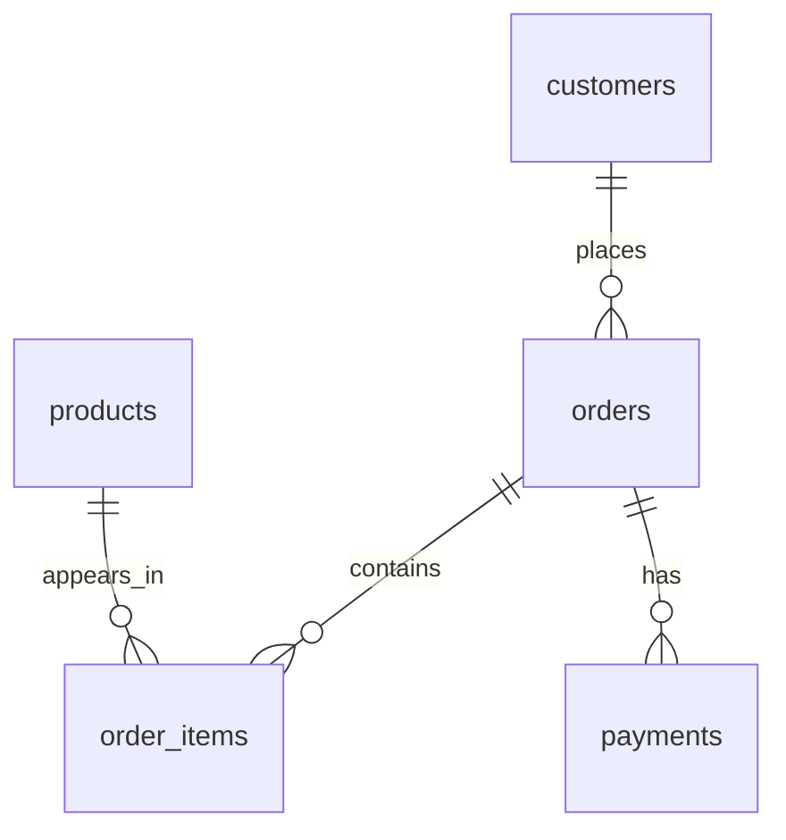

E-Commerce Sales & Customer Analytics | MySQL
SQL Portfolio Project · Riya Jain · Business & Data Analytics
Project Overview
This project explores e-commerce sales, customer purchasing behaviour, product performance, order outcomes and payment activity using a relational dataset. It demonstrates how SQL can convert transactional records into business metrics and answer practical questions for an e-commerce team.
Dataset: Synthetic data created for learning and portfolio demonstration. All monetary values are illustrative INR, not figures from a real company.

Business Objectives
- Measure sales value and order performance using consistent definitions.
- Identify valuable customers, products, categories and cities.
- Explore monthly sales trends and repeat purchasing.
- Examine order cancellations and payment failures.
- Validate transactional totals before drawing conclusions.
Dataset Overview
The dataset contains five related CSV tables and covers orders dated 1 January 2025 – 11 October 2026.
Table	Records	Description
customers	500	Customer profiles, locations, signup dates and segments
products	120	Product details, categories and cost prices
orders	1,800	Orders, customer references, dates, statuses and totals
order_items	4,598	Products, quantities and prices within orders
payments	1,800	Payment methods, amounts, dates and statuses

Database Relationships

Relationship keys: orders.customer_id → customers.customer_id; order_items.order_id → orders.order_id; order_items.product_id → products.product_id; payments.order_id → orders.order_id.
Tools & Skills
- MySQL: joins, filtering, grouping, aggregates, conditional logic, date functions and subqueries.
- Data modelling: primary and foreign keys, relational table grain and ER diagrams.
- Business analysis: KPI definitions, sales analysis, customer segmentation and data validation.
Data Cleaning & Validation
The dataset was supplied in an already-cleaned, analysis-ready format. No missing-value imputation, duplicate removal or other substantial cleaning was required as part of this project.

The analysis design includes these data-quality checks:
1. Check that primary keys are populated and unique.
2. Verify that foreign keys reference existing parent records.
3. Review nulls and treat repeated customer names or cities as valid values, not automatic duplicates.
4. Reconcile each order's recorded total with its item-level quantity × unit-price values.
5. Aggregate at the correct level to prevent inflated totals from multi-table joins.
These are validation rules, not claims that the original dataset contained those problems.
Business Questions & SQL Analysis
The 15 analysis questions are organised into four business areas:
Area	Business questions
Sales & trends	Total and delivered orders; delivered order value; monthly delivered sales; average delivered order value
Products & customers	Top five categories; top ten products by units; top ten customers by spending; highest-value cities; repeat buyer rate; customers who never ordered
Order operations	Monthly cancellation rate; distribution of order statuses
Payments & quality	Payment status distribution; payment-method failure rate; order total vs. item total mismatches

SQL file: Add your SQL query file to the repository (for example, sql/ecommerce_analysis.sql) and link it here after upload.

Supporting files: Add the ER diagram, source CSV files and any exported query results to clearly named repository folders. The analysis methodology and scope are also documented in Ecommerce_Project_Overview.docx.
Metric Definitions
Metric	Definition
Delivered order value	SUM(total_amount) for orders with status Delivered
Delivered average order value (AOV)	Delivered order value ÷ delivered order count
Category sales	SUM(quantity * unit_price) for delivered order lines
Cancellation rate	Cancelled orders ÷ all orders × 100
Repeat buyer rate	Customers with ≥2 delivered orders ÷ customers with ≥1 delivered order × 100
Payment failure rate	Failed payment records ÷ payment records within the same payment method × 100

Key Findings — Dataset Baseline
The figures below were calculated from the source CSVs and serve as benchmarks for checking SQL query outputs. They should not be presented as independently verified query results until the SQL outputs are compared.
1. Delivery completion: 1,288 of 1,800 orders (71.56%) have Delivered status.
2. Sales value: The total value of delivered orders is ₹56,19,662 (approximately ₹56.20 lakh).
3. Average order value: Delivered orders have an AOV of ₹4,363.09.
4. Cancellations: 101 orders (5.61%) are marked Cancelled.
5. Payment outcomes: Across 1,800 payment records, 1,496 succeeded (83.11%), 134 failed (7.44%), 86 were refunded, and 84 remain pending.
Interpretation note: Delivered orders and successful payments measure different events; they should not be equated. Detailed insights on leading categories, cities, products and customers require the corresponding SQL results.

Analytical Approach
1. Understand the grain, fields and relationships of each table.
2. Import CSVs into MySQL and inspect data types and referential integrity.
3. Define order-level, item-level and payment-level business metrics.
4. Write SQL queries to answer the 15 business questions.
5. Compare SQL outputs with source-data benchmark totals and document evidence-based insights.
Business Relevance
These analyses can inform decisions about which products or locations warrant attention, which customers contribute most to sales, and where order or payment friction may exist. The project demonstrates an analytics workflow, not confirmed commercial improvements.
Limitations
- The dataset is synthetic, so results do not establish real-world business performance.
- Delivered order value is a sales measure, not audited revenue or net profit.
- Operating expenses, taxes, discounts and shipping details are not modelled; profitability and delivery-speed analysis are outside scope.
- Payment status and order status are separate measures and should not be combined without care.

Author: Riya Jain
Focus: SQL · E-Commerce Analytics · Business Intelligence · Portfolio Project
